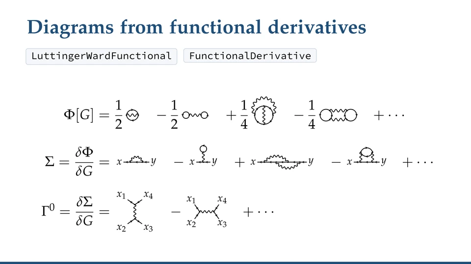
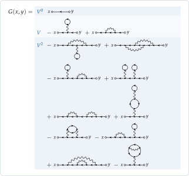
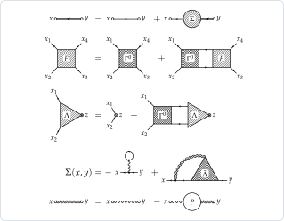
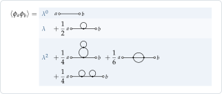
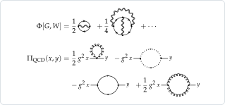
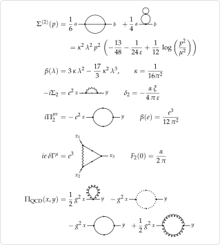
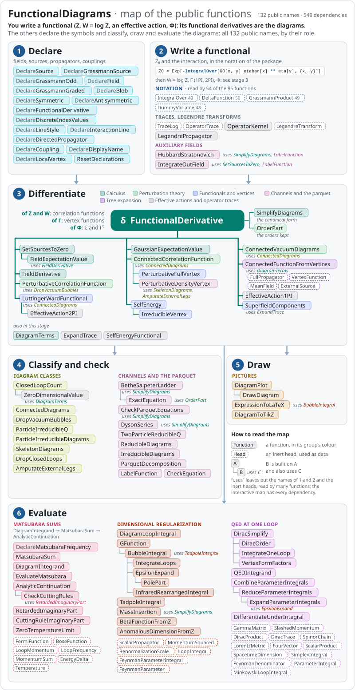

<p align="center">
  
</p>

<h1 align="center">Functional&#8203;Diagrams</h1>

<p align="center">
  <b>Feynman diagrams from functional derivatives</b><br>
  a Mathematica package for perturbation theory, effective actions and many-body physics
</p>

<p align="center">
  <a href="https://github.com/n4sd4q/FunctionalDiagrams/releases/latest"></a>
  
  <a href="Tests/RunTests.out"></a>
  <a href="https://github.com/n4sd4q/FunctionalDiagrams/actions/workflows/consistency.yml"></a>
  
</p>

<p align="center">
  <a href="https://n4sd4q.github.io/FunctionalDiagrams/"><b>Website</b></a>
  ·&nbsp;<a href="https://n4sd4q.github.io/FunctionalDiagrams/Showcase/FunctionalDiagrams_Showcase.pdf"><b>Showcase</b></a>
  ·&nbsp;<a href="https://n4sd4q.github.io/FunctionalDiagrams/Documentation/FunctionalDiagrams_Manual.pdf"><b>Manual</b></a>
  ·&nbsp;<a href="Examples.wl"><b>Guided&nbsp;tour</b></a>
  ·&nbsp;<a href="https://github.com/n4sd4q/FunctionalDiagrams/wiki"><b>Wiki</b></a>
  ·&nbsp;<a href="#installation"><b>Installation</b></a>
</p>

FunctionalDiagrams is a Mathematica package that derives Feynman diagrams the way one does on paper: from a generating
functional and an interaction, by functional derivatives with respect to the sources and the propagators, with the
fermion signs of the Grassmann algebra and the symmetry factors that the derivatives produce. It is meant for many-body
physics and effective actions, and also reaches relativistic field theory: φ⁴ theory, one-loop QED and the diagrams of
QCD.

The diagrams can be compared up to relabelling, sorted into classes, differentiated again, checked against exact
equations, evaluated in a few common cases, and drawn in Mathematica or exported as TikZ. Their labels are symbols, so
the same diagrams hold in any dimension, at zero or finite temperature and on the Keldysh contour.

<p align="center">
  <a href="https://n4sd4q.github.io/FunctionalDiagrams/Media/demo.mp4"></a><br>
  <sub>A preview of the <a href="https://n4sd4q.github.io/FunctionalDiagrams/Media/demo.mp4">demo video</a> (40 s): the
  electron gas of the first example below typed and run, then a few other results. The
  <a href="https://n4sd4q.github.io/FunctionalDiagrams/">website</a> plays it in the page.</sub>
</p>

## Installation

The package needs Mathematica 12.1 or later. Install the paclet of the latest
[release](https://github.com/n4sd4q/FunctionalDiagrams/releases) once:

```mathematica
PacletInstall["https://github.com/n4sd4q/FunctionalDiagrams/releases/download/v2.6.0/FunctionalDiagrams-2.6.0.paclet"]
```

then load it in every session:

```mathematica
Needs["FunctionalDiagrams`"]
```

The paclet (Mathematica's package archive) also carries the guided tour, a notebook to run cell by cell, and the two
PDFs. To open the tour:

```mathematica
NotebookOpen[PacletObject["FunctionalDiagrams"]["AssetLocation", "Examples"]]
```

(`SystemOpen` with `"Manual"` or `"Showcase"` in place of `"Examples"` opens a PDF.) ``?FunctionalDiagrams`*`` lists
the functions and `?Name` explains each one.

- In a notebook the package asks `api.github.com` once a day, in the background, whether a newer release is out;
  `$FunctionalDiagramsUpdateCheck = False` before `Needs` turns this off.
- Other ways (a downloaded `.paclet`, a clone with `PacletDirectoryLoad`, `Get` of the file), updating and removing,
  and the usual problems: the wiki's [Installation](https://github.com/n4sd4q/FunctionalDiagrams/wiki/Installation)
  page.

## A first example

```mathematica
Needs["FunctionalDiagrams`"]

(* free fermions, G0 = -<psi psibar>, and a two-body interaction V between densities *)
DeclareGrassmannSource[eta, etabar];
DeclareField[psi, etabar]; DeclareField[psibar, eta, -1];
Z0 = Exp[-IntegralOver[G0[x, y] etabar[x] ** eta[y], {x, y}]];
DeclareSymmetric[V]; DeclareInteractionLine[V]; DeclareDirectedPropagator[G0, G];
interaction =
  1/2 IntegralOver[V[x, y] psibar[x] ** psibar[y] ** psi[y] ** psi[x], {x, y}];

(* the Green function to second order: 1 + 2 + 10 diagrams, no vacuum bubbles *)
DiagramPlot[
  -PerturbativeCorrelationFunction[Z0, {psi[x], psibar[y]}, interaction, 2], {x, y}]
```

<p align="center"></p>
<p align="center">The output as <code>DiagramPlot</code> draws it, its orders in bands. A wavy line
<a href="https://github.com/n4sd4q/FunctionalDiagrams/wiki/Reading-the-Weights">stands for −V</a>, so that the number in
front of a picture times the values of its lines is the term.</p>

```mathematica
(* the Luttinger–Ward functional and its derivatives: Sigma(x, y) = dPhi/dG(y, x) and
   Gamma0(x1, x2; x3, x4) = dSigma(x1, x2)/dG(x4, x3), the irreducible vertex
   (the shortcuts SelfEnergy and IrreducibleVertex give the same) *)
Phi = LuttingerWardFunctional[Z0, interaction, 2, G0 -> G];
DiagramPlot[Phi]
DiagramPlot[FunctionalDerivative[Phi, G[y, x]], {x, y}]
DiagramPlot[FunctionalDerivative[Phi, G[x4, x3], G[x2, x1]], {x1, x2, x3, x4}]
```

<p align="center"></p>
<p align="center">The outputs: Φ[G] and its derivatives Σ and Γ⁰, to second order.</p>

```mathematica
(* phi^4 theory: a real boson with the free propagator D0 = <phi phi>_0 and the interaction
   lambda/4! phi^4; its propagator to second order: 1 + 1 + 3 diagrams *)
DeclareSource[J]; DeclareField[phi, J]; DeclareSymmetric[D0]; DeclareCoupling[lambda];
Z0phi = Exp[1/2 IntegralOver[J[x] D0[x, y] J[y], {x, y}]];
DiagramPlot[PerturbativeCorrelationFunction[Z0phi, {phi[a], phi[b]},
  lambda/4! IntegralOver[phi[z]^4, {z}], 2], {a, b}]
```

<p align="center"></p>
<p align="center">The output. A vertex stands for −λ (<code>DeclareCoupling</code>), so that the tadpole has the weight
½.</p>

**Next.** The [guided tour](Examples.wl) ([notebook](https://n4sd4q.github.io/FunctionalDiagrams/Examples.nb)) goes
on from here in thirteen short sections, up to QED and QCD. The wiki shows how to
[declare a theory](https://github.com/n4sd4q/FunctionalDiagrams/wiki/Declaring-a-Theory) of your own and
[which function gives](https://github.com/n4sd4q/FunctionalDiagrams/wiki/FAQ#which-function-gives-the-object-i-need)
the object you need; ``?FunctionalDiagrams`*`` lists the functions and `?Name` explains each one.

## Gallery

Drawn by the package; the [showcase](https://n4sd4q.github.io/FunctionalDiagrams/Showcase/FunctionalDiagrams_Showcase.pdf) derives and checks each one.

<p align="center"></p>
<p align="center"><b>Exact equations.</b> Dyson, Bethe–Salpeter, the vertex Λ of the density and the parquet
decomposition of the full vertex F, drawn with blobs and checked order by order.</p>

<p align="center"></p>
<p align="center"><b>Screening.</b> Hedin's equations, and the functional Φ[G, W] of the dressed lines with its
derivatives: the <i>GW</i> approximation and its vertex corrections.</p>

<p align="center"></p>
<p align="center"><b>Pairing.</b> The Nambu superfield (ψ, ψ̄): Φ in the normal and anomalous propagators (two arrows),
the Gor'kov equations, Hartree–Fock and the BCS gap Δ.</p>

<p align="center"></p>
<p align="center"><b>Field theory.</b> φ⁴ theory to two loops in dimensional regularization, one-loop QED up to the
anomalous magnetic moment, and the gluon self-energy of QCD.</p>

## Documentation

| Document | Contents |
|---|---|
| [**Website**](https://n4sd4q.github.io/FunctionalDiagrams/) | the package on one page: what it does, the demo video, the first example, installation, the documents, how to cite |
| [**Showcase**](https://n4sd4q.github.io/FunctionalDiagrams/Showcase/FunctionalDiagrams_Showcase.pdf) (PDF) | the physics, step by step, for the electron gas and φ⁴ theory: many-body theory, quantum field theory, and the tools (pictures, formulas, how the package works) |
| [**Manual**](https://n4sd4q.github.io/FunctionalDiagrams/Documentation/FunctionalDiagrams_Manual.pdf) (PDF) | every function, option and convention, with examples computed by the package |
| [**Guided tour**](Examples.wl) | a notebook to run: in the paclet ([Installation](#installation)) or [to download](https://n4sd4q.github.io/FunctionalDiagrams/Examples.nb); [`Examples.wl`](Examples.wl) is the same as a script |
| [**Wiki**](https://github.com/n4sd4q/FunctionalDiagrams/wiki) | practical guides and a FAQ |
| [**Map of the functions**](https://n4sd4q.github.io/FunctionalDiagrams/Documentation/function_map.html) | every public name by its role in a calculation, interactive |

## What it does

- **Diagrams from a generating functional**: Wick's theorem, Z and log Z order by order, and the classes of diagrams:
  connected, one- and two-particle irreducible, skeleton, reducible in a channel.
- **Effective actions and exact equations**: the 1PI and 2PI actions, Φ[G] and its derivatives, Bethe–Salpeter and
  parquet, Schwinger–Dyson and Hedin's equations, pairing with Nambu superfields.
- **Evaluating diagrams**: Matsubara sums, loop integrals in dimensional regularization, one-loop QED.
- **Pictures and formulas**: diagrams drawn as in many-body papers, in a notebook or as TikZ, and formulas as LaTeX.

The theories are written in condensed notation, so the same functions serve real and complex bosons, fermions, phonons,
disorder and QCD (quarks, gluons, ghosts).

<details>
<summary>Everything it does, with the names of the functions</summary>

**Diagrams from a generating functional**
- functional derivatives with bosonic and Grassmann sources, chain rule, implicit dependence; a canonical form in which
  equal diagrams are recognized (`FunctionalDerivative`, `SimplifyDiagrams`)
- Wick's theorem; Z[J] and W = log Z order by order, at zero or non-zero source; vacuum bubbles and the linked-cluster
  theorem (`PerturbativeCorrelationFunction`, `ConnectedCorrelationFunction`, `ConnectedVacuumDiagrams`)
- classes of diagrams: connected, one- and two-particle irreducible, skeleton, reducible in a channel; amputation;
  Dyson series (`ParticleIrreducibleDiagrams`, `SkeletonDiagrams`, `IrreducibleDiagrams`, `AmputateExternalLegs`)

**Effective actions and exact equations**
- 1PI vertices as derivatives of the 1PI action, and connected functions as trees of propagators and vertices, for
  bosons and fermions (`ConnectedFunctionFromVertices`; the shortcut `PerturbativeFullVertex` computes the vertices from
  the connected functions)
- the Luttinger–Ward functional Φ[G], with Σ = δΦ/δG and Γ⁰ = δΣ/δG taken by `FunctionalDerivative`, also for several
  propagators (`LuttingerWardFunctional`; the shortcuts `SelfEnergy`, `IrreducibleVertex`)
- the 2PI effective action Γ[G] and Γ[φ̄, G], the 1PI effective action Γ[φ̄] and Potthoff's self-energy functional as
  objects, with traces of operators, derivatives with respect to two-index objects, the grand potential and conserving
  responses evaluated in Matsubara frequency, and exact zero-dimensional checks (`EffectiveAction2PI`,
  `EffectiveAction1PI`, `SelfEnergyFunctional`, `TraceLog`, `ZeroDimensionalValue`)
- Bethe–Salpeter ladders and the parquet decomposition, for fermions (ph, ph̄, pp) and bosons (s, t, u): the fully
  irreducible vertex and the kernels of the channels as derivatives of the 2PI action, the classification by cutting
  lines as the check (`BetheSalpeterLadder`, `ParquetDecomposition`)
- superfields: the Nambu propagator of (ψ, ψ̄), anomalous parts included, as the variable of the 2PI functional, which
  gives the kernels of all three channels, is exact at finite means and yields Hartree–Fock–Bogoliubov and the BCS gap
  equation at first order (`"Statistics" -> "Superfield"`, `SuperfieldComponents`)
- Dyson, Bethe–Salpeter, parquet, Schwinger–Dyson and Hedin's equations and the vertex of a one-body operator, drawn
  with blobs or checked order by order against perturbation theory (`ExactEquation`, `CheckEquation`, `DeclareBlob`)
- Hubbard–Stratonovich fields in both directions, and the functional Φ[G, W] whose first diagram is the *GW*
  approximation (`HubbardStratonovich`, `IntegrateOutField`)

**Evaluating diagrams**
- momenta and Matsubara frequencies routed through a diagram, frequency sums by residues with Fermi and Bose
  functions, analytic continuation, and the cutting rules at finite temperature (`EvaluateMatsubara`, `MatsubaraSum`,
  `CheckCuttingRules`)
- loop integrals in dimensional regularization, done one loop after the other (tadpoles, bubbles, G-functions), with
  the Laurent expansion in ε, MS-bar Z factors and renormalization-group functions; φ⁴ theory to two loops
  (`DiagramLoopIntegral`, `IntegrateLoops`, `EpsilonExpand`, `BetaFunctionFromZ`)
- QED at one loop: Dirac algebra in d dimensions, Feynman parameters and tensor reduction, the electron self-energy, the
  vacuum polarization and the vertex, with their renormalization constants and β(e) (`QEDIntegrand`, `DiracSimplify`, `IntegrateOneLoop`,
  `VertexFormFactors`)

**Pictures and formulas**
- diagrams in the usual style of many-body papers (fermion lines straight, loops as circles, ladders as ladders,
  symmetric diagrams drawn symmetric), exact equations with blobs, and formulas as LaTeX (`DiagramPlot`,
  `DiagramToTikZ`, `ExpressionToLaTeX`); in a notebook the pictures follow its light or dark appearance

</details>

**Scope.** The package computes exact symbolic sums of diagrams; it is not a program for the numerical evaluation of
Feynman integrals. It does the frequency sums at finite temperature (the momentum integrals stay symbolic), the loop
integrals that reduce to nested one-loop ones in dimensional regularization, and one-loop QED. The number of diagrams
grows factorially with the order: the Green function of the electron gas has 706 diagrams at fourth order and 8162 at
fifth ([timings](https://github.com/n4sd4q/FunctionalDiagrams/wiki/FAQ#how-high-an-order-can-i-compute)). The pictures
follow rules made for many-body diagrams and trees of vertex functions; other diagrams get a general layout, readable
but not always as in a textbook.

## Checks

The results are checked against each other, order by order, and the showcase reports every residual: for the electron
gas and φ⁴ theory to third order, the Dyson equation and the linked-cluster theorem, Σ[G] against the skeleton part of
the perturbative Σ, the Ward identity, the Bethe–Salpeter, parquet, Schwinger–Dyson and Hedin equations. The evaluation
is checked against numbers (brute-force frequency sums, the cutting rules, numerical integration in non-integer
dimension) and against textbook results (β functions, the Ising exponents at the Wilson–Fisher fixed point, Z₁ = Z₂,
the anomalous magnetic moment). The code printed in the showcase, in the wiki and on this page is run, and gives what
is shown after it.

## Related software

[FeynArts](https://feynarts.de) and QGRAF ([Nogueira 1993](https://doi.org/10.1006/jcph.1993.1074)) generate the
Feynman diagrams of a process from the fields and couplings of a model, and [FeynCalc](https://feyncalc.github.io) does
their Dirac and colour algebra and reduces one-loop integrals to scalar ones. [DoFun](https://github.com/markusqh/DoFun)
and [QMeS-Derivation](https://github.com/QMeS-toolbox/QMeS-Derivation) derive Dyson–Schwinger and functional
renormalization group equations, the first from an action, the second from a master equation, also by functional
derivatives. FunctionalDiagrams works order by order with the objects of many-body theory and effective actions:
correlation and vertex functions, Φ[G] and its derivatives, channels and parquet equations, self-consistent
approximations; and it checks its exact equations against the perturbative series. Its evaluation tools are much more
limited than FeynCalc's, so for real loop calculations the two are better used together.

## Map of the functions

<p align="center"><a href="https://n4sd4q.github.io/FunctionalDiagrams/Documentation/function_map.html"></a></p>

The public functions by their role in a calculation: declare the symbols, write a functional, differentiate it, then
classify, draw and evaluate the diagrams. Click the map for the
[interactive version](https://n4sd4q.github.io/FunctionalDiagrams/Documentation/function_map.html): select a name to read
its usage message and to see what it uses and what uses it.

## Details

<details>
<summary>Conventions</summary>

All of them, with the effective actions and the units, are on the wiki's
[Conventions](https://github.com/n4sd4q/FunctionalDiagrams/wiki/Conventions) page.

* `IntegralOver[f, {x, y, ...}]` is the integral (or sum) over the labels `x, y, ...`, which stand for position, time,
  spin and any other index; `DeltaFunction[x, y]` is the delta function. Labels are symbols. The diagrams do not depend
  on what a label is: the same results hold in any dimension, at zero or finite temperature, and on the Keldysh contour.
* Grassmann-odd factors are multiplied with `**`; `FunctionalDerivative[F, s1, ..., sn]` is the left derivative
  δ/δs1 … δ/δsn F, the rightmost acting first.
* Results are in canonical form: the integration variables are renamed `z1, z2, ...`, so that equal diagrams are
  recognized and `SimplifyDiagrams[a - b]` is 0 exactly when `a` and `b` are equal.
* Fermions: `G0 = -<psi psibar>`, the free generating functional is `Exp[-IntegralOver[G0[x, y] etabar[x] ** eta[y], {x, y}]]`,
  `psi` ↔ δ/δ`etabar`, `psibar` ↔ −δ/δ`eta`; `G[x, y]` is drawn as an arrow from `y` to `x`. The interaction is
  `1/2 ∫ V(x, y) psibar(x) psibar(y) psi(y) psi(x)`.
* The number written in front of a picture, times the values of its elements, is the term: a propagator stands for
  itself, an interaction line for −V and a vertex for minus its coupling (−λ in φ⁴ theory, `DeclareCoupling`): the minus
  sign comes from expanding exp(−S_int). So Fock has the weight +1, Hartree −1 (its closed fermion loop), the φ⁴ tadpole +½.
* QED: the electron has the charge −e, with e > 0 everywhere, and the vertex is +ieγ^μ (Peskin and Schroeder with e → −e).
* Σ(x, y) = δΦ/δG(y, x) and Γ⁰(x1, x2; x3, x4) = δΣ(x1, x2)/δG(x4, x3): fermions leave a vertex at `x1, x3` and enter at
  `x2, x4`. In code: `FunctionalDerivative[Phi, G[y, x]]` and `FunctionalDerivative[Phi, G[x4, x3], G[x2, x1]]`.
* Real bosons (`G = <phi phi>`, declared symmetric): Σ(x, y) = −2δΦ/δG(x, y) and Γ⁰ = −2δΣ/δG = 4δ²Φ/δGδG, the kernel of
  the channel s; for the Nambu field (ψ, ψ̄) with its antisymmetric propagator 𝒢 the same, Σ = −2δΦ/δ𝒢. The shortcuts take
  `"Statistics" -> "Boson"` or `"Superfield"` (without it, on a symmetric G, a message).
* Names of propagators and fields must not be built-in symbols (`GreenFunction`, `Gamma`, `C`, `D`, `E`, `I`, `K`, `N`,
  `O`, …): the package warns. Hence `BareGreenFunction`, `DressedGreenFunction`.

</details>

<details>
<summary>Performance</summary>

Wick's theorem is applied as a sum over pairings in which the interchangeable legs of a vertex are contracted only once,
with their multiplicity, and the canonical form uses colour refinement and individualization, as graph-isomorphism
programs do; the refinement (of most terms) and the tests of irreducibility run on integers, in compiled functions. As
scripts, the guided tour runs in about 12 s, the test suite in about a minute (twenty-five seconds without the effective
actions), and the script that computes and draws everything in the showcase in a little over two minutes.

</details>

<details>
<summary>Contents of the repository</summary>

| File | Contents |
|---|---|
| `FunctionalDiagrams.wl` | the package, a single file |
| `Examples.nb`, `Examples.wl` | the guided tour (notebook, and the same as a script) |
| `Showcase/` | the showcase: `make_figures.wl` computes and draws everything in it, `build_pdf.sh` typesets it |
| `wiki/` | the pages of the wiki, published to it by `.github/workflows/wiki.yml` |
| `Documentation/` | the reference manual (`make_examples.wl` computes its examples, `build_manual.sh` typesets it) and the map of the functions |
| `Tests/` | the test suite `RunTests.wl` and its last output `RunTests.out`; `QEDOneLoop.wl`, the one-loop QED computation used by the tests; `MatsubaraBruteForce.wl`, the brute-force Matsubara sums used by the tests and the showcase; `EffectiveActions.wl`, the tests of the effective actions, with two slow references stored in `FullyIrreducibleVertices.m`; `Superfields.wl`, the tests of the superfields; `Harness.wl`, the helpers they share |
| `Media/` | the demo video and its preview |
| `Logo/` | the logo: the exchange (Fock) vacuum diagram, one of the two first-order diagrams of the Luttinger–Ward functional |
| `Development/` | the sources of the package, one file per part, and the scripts that assemble it, build the paclet and draw the pictures of this page |
| `PacletInfo.wl` | the paclet: the repository can be loaded as it is |
| `index.html` | the [website](https://n4sd4q.github.io/FunctionalDiagrams/), served by GitHub Pages and written by `Development/make_site.py` |
| `CHANGELOG.md`, `CITATION.cff`, `CONTRIBUTING.md`, `SECURITY.md`, `LICENSE`, `NOTICE` | the history, how to cite, how to report a problem or contribute, the package's network access (its update check) and how to report a vulnerability, the text of the license, the copyright and the additional terms |

</details>

<details>
<summary>Running the tests</summary>

```sh
wolfram -script Tests/RunTests.wl     # or: wolframscript -file Tests/RunTests.wl
```

Every check prints PASS or FAIL; `Tests/RunTests.out` is the output of the last run.

</details>

## Questions and problems

The wiki's [FAQ](https://github.com/n4sd4q/FunctionalDiagrams/wiki/FAQ) answers the questions of the first days.
Problems, questions and suggestions are welcome as
[issues](https://github.com/n4sd4q/FunctionalDiagrams/issues/new/choose); [`CONTRIBUTING.md`](CONTRIBUTING.md) says what
helps.

## Citing

If you use FunctionalDiagrams in published work, please cite it as described in [`CITATION.cff`](CITATION.cff)
(GitHub shows a *Cite this repository* button), for example

```bibtex
@software{Africani_FunctionalDiagrams,
  author = {Africani, Nazzareno},
  title  = {{FunctionalDiagrams}: functional derivatives and {Feynman}
            diagrams in {Mathematica}},
  year   = {2026},
  url    = {https://github.com/n4sd4q/FunctionalDiagrams}
}
```

The history of the package is in [`CHANGELOG.md`](CHANGELOG.md).

## Star history

<p align="center"><a href="https://star-history.com/#n4sd4q/FunctionalDiagrams&amp;Date"></a></p>

## License

Released under the [GNU General Public License, version 3 or later](LICENSE), with two additional terms: the attribution
to the author must be kept, and modified versions must say that they are modified, by whom and when (see
[`NOTICE`](NOTICE), with the copyright and the terms). Author: Nazzareno Africani (SISSA).
