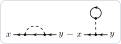

# Declaring a theory

A theory is three things: the **sources** and the **fields** that are derivatives with respect to them, a free
generating functional **Z0** written with the propagators, and an **interaction** written with the fields. The
declarations tell the package which symbols are which, and how to draw them. As an example, electrons coupled to
phonons, with the vertex g ∫ φ ψ̄ψ:

```mathematica
Needs["FunctionalDiagrams`"]
(* sources, and the fields that are derivatives with respect to them *)
DeclareGrassmannSource[eta, etabar]; DeclareSource[J];
DeclareField[psi, etabar]; DeclareField[psibar, eta, -1]; DeclareField[phi, J];
(* the propagators: the electron line has an arrow, the phonon line is symmetric and dashed *)
DeclareDirectedPropagator[G0]; DeclareSymmetric[D0]; DeclareLineStyle[D0, "Dashed"];
(* the coupling: each vertex of a picture stands for -g *)
DeclareCoupling[g];
Z0 = Exp[-IntegralOver[G0[x, y] etabar[x] ** eta[y], {x, y}] +
    1/2 IntegralOver[J[x] D0[x, y] J[y], {x, y}]];
interaction = g IntegralOver[phi[z] psibar[z] ** psi[z], {z}];
```

The electron self-energy at order g², the amputated one-particle-irreducible part of the Green function:

```mathematica
green = -PerturbativeCorrelationFunction[Z0, {psi[x], psibar[y]}, interaction, {2}];
sigma = AmputateExternalLegs[ParticleIrreducibleDiagrams[green, 1, {x, y}, {G0}],
  {x, y}, {G0}];
DiagramPlot[sigma, {x, y}]
```



The tadpole is the mean field of the phonon; the second diagram is Migdal's self-energy.

## The declarations

| declaration | what it says |
|---|---|
| `DeclareSource[J]`, `DeclareGrassmannSource[eta, etabar]` | `J[x]` is a commuting source, `eta[x]` an anticommuting one: `FunctionalDerivative` differentiates them |
| `DeclareField[phi, J]`, `DeclareField[psibar, eta, -1]` | `phi[x]` is δ/δJ(x), `psibar[x]` is −δ/δη(x) |
| `DeclareSymmetric[D0]`, `DeclareAntisymmetric[A]` | `D0[x, y] = D0[y, x]`; `A[y, x] = -A[x, y]` (a superfield propagator). Declare before using the symbol: it acts on the expressions evaluated afterwards |
| `DeclareDirectedPropagator[G0]` | `G0[x, y]` is an arrow from `y` to `x` |
| `DeclareLineStyle[h, style]` | how a two-label factor is drawn: `"Plain"`, `"Arrow"`, `"DoubleArrow"`, `"DottedArrow"`, `"Double"`, `"Wavy"`, `"DoubleWavy"`, `"Curly"`, `"Dashed"`, `"Dotted"`, `"Zigzag"`, `"Impurity"`, `"DivergingArrows"`, `"ConvergingArrows"`; the line stands for itself |
| `DeclareInteractionLine[V]` | `V[x, y]` is an interaction line, wavy (or the style given), standing for −V in the weights |
| `DeclareCoupling[g]` | the coupling is absorbed into the vertices of the pictures, each standing for −g |
| `DeclareLocalVertex[h]` | `h[x, y, z]` is one point with several indices (the quark–gluon vertex), drawn as a vertex, standing for −h |
| `DeclareBlob[h, "label"]` | `h[x1, ..., xn]` is a blob with a LaTeX label (exact equations, see [Exact equations](Exact-Equations)) |
| `DeclareDisplayName[h, "name"]` | `h[x, y]` is shown as name with the subscript x y in a notebook |
| `DeclareDiscreteIndexValues[{up, down}]` | discrete labels: `DeltaFunction[up, down]` is 0 (spin) |
| `DeclareFunctionalDerivative[...]` | the derivative of an object that depends on a source implicitly (a line in an external potential) |
| `DeclareMatsubaraFrequency[w, "Fermion"]` | `w` is a fermionic Matsubara frequency |
| `ResetDeclarations[]` | forget all of the above |

The manual, section *Declarations*, has every option; the showcase declares phonons, disorder, QED and QCD.

## Good practice

- **Names.** Heads of fields, sources and propagators must be symbols that are not built into the Wolfram Language:
  not `C`, `D`, `E`, `I`, `K`, `N`, `O`, `Gamma`, `GreenFunction` (the [FAQ](FAQ#why-does-a-name-like-c-or-d-fail) shows
  what happens). Labels (`x`, `y`, `x1`, ...) must be symbols too.
- **Order.** The order of the declarations does not matter (a field may be declared before its source), but a
  symmetry acts only on what is evaluated after it.
- **Several propagators.** A theory may have any number of fields; each propagator is a factor of `Z0`, and the
  functions that need the lines take them as a list, `{G0, D0}`.
- **Interaction or propagator.** A boson that is part of the theory (a phonon, a photon, a Hubbard–Stratonovich field)
  is a propagator: declare it with `DeclareLineStyle`. An interaction kernel that stands for exp(−S_int) (the Coulomb
  V) is an interaction line: `DeclareInteractionLine`. The weights differ by the sign, see
  [Reading the weights](Reading-the-Weights).
- **The same symbols elsewhere.** Declarations are global in the session: to start another theory with the same
  names, call `ResetDeclarations[]` first.
