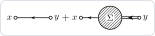
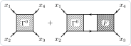

`ExactEquation` writes the exact equations of many-body theory (Dyson, Bethe–Salpeter, parquet, Schwinger–Dyson, the
vertex of the density, Hedin's equations, the response) between full objects. The same equation can be **drawn**, with
the objects as blobs, or **checked**, with the objects as perturbative series, order by order.

## Drawing an equation

The objects are heads: blobs declared with `DeclareBlob`, and lines. The Dyson equation G = G₀ + G₀ΣG, with the full
propagator as a double line next to the bare one:

```mathematica
Needs["FunctionalDiagrams`"]
DeclareDirectedPropagator[G0]; DeclareLineStyle[G, "DoubleArrow"];
DeclareBlob[SigmaBlob, "\\Sigma"];
dyson = ExactEquation["Dyson", {"G" -> G, "G0" -> G0, "Sigma" -> SigmaBlob}, {x, y}];
DiagramPlot[Last[dyson], {x, y}]
```



`ExactEquation` gives `lhs == rhs`; `Last` is the right-hand side. The names of the equations and of their objects are
in the usage message, `?ExactEquation`, and in the manual, section *Exact equations*.

## Fills

The fill of a blob (the option `"Fill"` of `DeclareBlob`) says what it stands for. The documents of the package follow
one rule: a vertex function is filled the more densely the more diagrams it contains, and a correlation or response
function is white.

| `"Fill"` | objects |
|---|---|
| `"Dotted"` | the fully irreducible vertex Γ_irr |
| `"Hatched"` (the default) | the irreducible parts: Σ, Δ, P, Γ⁰, Γ_ph, Γ_ph̄, Γ_pp, Γ_xc, Λ̃ |
| `"CrossHatched"` | the full vertex functions: F, Λ, Γ⁽⁴⁾ |
| `"White"` | the correlation and response functions: W⁽⁴⁾, L, χ |

The Bethe–Salpeter equation F = Γ⁰ + Γ⁰L₀F, the irreducible vertex hatched and the full one cross-hatched; every line
is a full propagator, a plain line, since no bare one appears:

```mathematica
DeclareDirectedPropagator[Gd];
DeclareBlob[Gamma0Box, "\\Gamma^0", "Shape" -> "Box"];
DeclareBlob[FBox, "F", "Shape" -> "Box", "Fill" -> "CrossHatched"];
bs = ExactEquation["BetheSalpeter", {"F" -> FBox, "Gamma0" -> Gamma0Box, "G" -> Gd},
   {x1, x2, x3, x4}];
DiagramPlot[Last[bs], {x1, x2, x3, x4}]
```



## Checking an equation

For a check, the objects are functions of their labels: perturbative series wrapped in `LabelFunction`. The Dyson
equation of the electron gas to second order, with the Green function and the self-energy computed independently:

```mathematica
DeclareGrassmannSource[eta, etabar];
DeclareField[psi, etabar]; DeclareField[psibar, eta, -1];
Z0 = Exp[-IntegralOver[G0[x, y] etabar[x] ** eta[y], {x, y}]];
DeclareSymmetric[V]; DeclareInteractionLine[V];
interaction =
  1/2 IntegralOver[V[x, y] psibar[x] ** psibar[y] ** psi[y] ** psi[x], {x, y}];
green = -PerturbativeCorrelationFunction[Z0, {psi[x], psibar[y]}, interaction, 2];
sigma = AmputateExternalLegs[ParticleIrreducibleDiagrams[green, 1, {x, y}, {G0}],
  {x, y}, {G0}];
check = ExactEquation["Dyson", {"G" -> LabelFunction[green, {x, y}],
    "G0" -> G0, "Sigma" -> LabelFunction[sigma, {x, y}]}, {x, y},
   "MaximumOrder" -> {V, 2}];
CheckEquation[check, V, 2]
```

```text
{0, 0, 0}
```

`CheckEquation[lhs == rhs, V, n]` gives the residuals of the orders 0 to n: all zero, the equation holds to second
order. `"MaximumOrder" -> {V, 2}` keeps the products of two series from growing beyond the order checked.

## Notes

- A wrong sign or a missing diagram shows up as a non-zero residual at the order where it enters; `DiagramPlot` of the
  residual draws what is missing.
- Four-point equations use the convention of the vertex: fermions leave at x₁, x₃ and enter at x₂, x₄
  ([Conventions](Conventions#self-energy-and-vertices)); `"Channel"` chooses the channel of `"BetheSalpeter"`.
- `"Statistics" -> "Boson"` gives the equations of a real boson (φ⁴ theory).
- The showcase checks the Dyson, Bethe–Salpeter, parquet, Schwinger–Dyson and vertex equations for the electron gas and
  φ⁴ theory, and Hedin's equations for the electron gas, to third order, and draws them.
