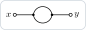
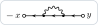

The code on this page runs in one session, from the top; the second answer declares the electron gas that the later
ones use.

## Which function gives the object I need?

The objects of a calculation are derivatives of a few generating functionals (Z, log Z, the Luttinger–Ward functional
Φ, the effective actions), and the package computes them as such; the functions named after the objects are shortcuts
that give the same results. For the electron gas of the README (`Z0`, `interaction`, the propagator `G0` made full as
`G`):

| object | what it is | function |
|---|---|---|
| Green function G(x, y) = −⟨T ψ(x) ψ̄(y)⟩ | a derivative of Z with respect to η̄(x) and η(y) | `-PerturbativeCorrelationFunction[Z0, {psi[x], psibar[y]}, interaction, n]` |
| connected functions | derivatives of log Z | `ConnectedCorrelationFunction[Z0, {psi[x1], psibar[x2], ...}, interaction, n]` |
| connected vacuum diagrams | log(Z/Z₀) | `ConnectedVacuumDiagrams[Z0, interaction, n]` |
| Luttinger–Ward functional Φ[G] | minus the 2PI vacuum diagrams, with G₀ → G | `LuttingerWardFunctional[Z0, interaction, n,`<br>`G0 -> G]` |
| self-energy Σ(x, y) | δΦ/δG(y, x): `FunctionalDerivative[Phi, G[y, x]]` | `SelfEnergy[Phi, G, {x, y}]` |
| irreducible vertex Γ⁰(x₁, x₂; x₃, x₄) | δ²Φ/δG(x₄, x₃)δG(x₂, x₁): `FunctionalDerivative[Phi, G[x4, x3], G[x2, x1]]` | `IrreducibleVertex[Phi, G, {x1, x2, x3, x4}]` |
| 1PI effective action Γ[Ψ̄, Ψ] | Legendre transform of −log Z in η, η̄ | `EffectiveAction1PI[Z0, interaction, n,`<br>`{psi -> Psi, psibar -> Psibar},`<br>`G0 -> G0]` |
| full vertex F(x₁, x₂; x₃, x₄) | the fourth derivative of the 1PI action with respect to the means | `PerturbativeFullVertex[Z0, interaction, n,`<br>`{psi, psibar}, {x1, x2, x3, x4},`<br>`G0 -> G]` |
| vertex of the density Λ(x₁, x₂; z) | −δG⁻¹(x₁, x₂)/δU(z), U coupled to the density | `PerturbativeDensityVertex[Z0, interaction, n,`<br>`{psi, psibar}, {x1, x2, z},`<br>`G0 -> G]` |
| 2PI effective action Γ[G] | Legendre transform of −log Z in the two-point source | `EffectiveAction2PI[Phi, G0 -> G]` |

The effective actions are written out in [Conventions](Conventions#effective-actions). The
[map of the functions](https://n4sd4q.github.io/FunctionalDiagrams/Documentation/function_map.html) places every
public name by its role in a calculation, and `?Name` gives its usage message.

## What is the difference between PerturbativeCorrelationFunction and ConnectedCorrelationFunction?

`PerturbativeCorrelationFunction` is the expectation value ⟨…⟩ = ⟨… e^(−S_int)⟩₀/⟨e^(−S_int)⟩₀: the vacuum bubbles cancel,
but a function of four or more fields keeps its disconnected terms. `ConnectedCorrelationFunction` is the cumulant, the
derivative of log Z, with only the diagrams in which all the external points are connected. The four-point function of
free fermions (order 0):

```mathematica
Needs["FunctionalDiagrams`"]
DeclareGrassmannSource[eta, etabar];
DeclareField[psi, etabar]; DeclareField[psibar, eta, -1];
Z0 = Exp[-IntegralOver[G0[x, y] etabar[x] ** eta[y], {x, y}]];
DeclareSymmetric[V]; DeclareInteractionLine[V]; DeclareDirectedPropagator[G0];
interaction =
  1/2 IntegralOver[V[x, y] psibar[x] ** psibar[y] ** psi[y] ** psi[x], {x, y}];
fields = {psi[x1], psibar[x2], psi[x3], psibar[x4]};
PerturbativeCorrelationFunction[Z0, fields, interaction, 0]
ConnectedCorrelationFunction[Z0, fields, interaction, 0]
```

```text
-(G0[x1, x4] G0[x3, x2]) + G0[x1, x2] G0[x3, x4]
0
```

For the Green function, a function of two fields, the two are the same.

## Why does a name like C or D fail?

The symbols built into the Wolfram Language have definitions of their own, which act before those of the package:
`D[x, y]` is a derivative, and it is zero.

```mathematica
D[x, y]
DeclareSymmetric[D];
```

```text
0
FunctionalDiagrams::builtin: D is a built-in symbol of the Wolfram Language, whose own definitions interfere with the package: use another name.
```

The package warns when a declaration names a built-in symbol. The usual ones to avoid are `C`, `D`, `E`, `I`, `K`,
`N`, `O`, `Beta`, `Gamma` and `GreenFunction`; use names that are not built in, such as `D0` or `Dph` for a phonon
propagator and `Q` for a symmetric kernel. `Context[name]` is ``"System`"`` for a built-in symbol.

## Why is a derivative zero?

`FunctionalDerivative` differentiates only with respect to declared sources (and to two-index kernels such as `G[x, y]`,
which need no declaration):

```mathematica
FunctionalDerivative[J[x] J[y], J[z]]
```

```text
FunctionalDerivative::nosource: J[z] is not a declared source (DeclareSource, DeclareGrassmannSource): the derivative with respect to it is 0.
0
```

Declare the source first:

```mathematica
DeclareSource[J];
FunctionalDerivative[J[x] J[y], J[z]]
```

```text
DeltaFunction[y, z] J[x] + DeltaFunction[x, z] J[y]
```

## Why must Grassmann factors be multiplied with `**`?

`Times` sorts its factors, so that their order, and with it the sign of a product of Grassmann-odd factors, is lost.
The package refuses such a product and stops the evaluation:

```mathematica
FunctionalDerivative[etabar[x] eta[y], eta[z], etabar[w]]
```

```text
FunctionalDerivative::times: Grassmann-odd factors are multiplied with Times in eta[y] etabar[x]: Times sorts its factors, so that their order and the sign are lost. Write the product with ** ; the evaluation is aborted.
$Aborted
```

The message shows the factors as `Times` has already sorted them.

With `**` the order is kept, and the derivatives, from the left and the rightmost first, give the signs:

```mathematica
FunctionalDerivative[etabar[x] ** eta[y], eta[z], etabar[w]]
FunctionalDerivative[etabar[x] ** eta[y], etabar[w], eta[z]]
```

```text
DeltaFunction[w, x] DeltaFunction[y, z]
-(DeltaFunction[w, x] DeltaFunction[y, z])
```

## Why do two equal results look different?

The functions of the package give their results in canonical form, with the internal points renamed `z1, z2, ...` by
a canonical labelling: the names do not follow the order in which you wrote the points, and an expression you build
yourself is in canonical form only after `SimplifyDiagrams`. Compare two results with `SimplifyDiagrams[a - b]`, which
is `0` exactly when they are the same sum of diagrams; see
[Orders and simplification](Orders-and-Simplification#comparing-results).

## Why is my diagram drawn with plain lines?

The pictures draw what the declarations say: an arrow for a propagator declared with `DeclareDirectedPropagator`, a
wavy line for `DeclareInteractionLine`, a dashed one for `DeclareLineStyle[h, "Dashed"]`, and so on. A two-label factor
that is not declared is a plain line, and a factor of three or more labels a small hatched disc:

```mathematica
fock = IntegralOver[Gx[x, u] Vx[u, v] Gx[u, v] Gx[v, y], {u, v}];
DiagramPlot[fock, {x, y}]
```



```mathematica
DeclareDirectedPropagator[Gx]; DeclareInteractionLine[Vx];
DiagramPlot[fock, {x, y}]
```



The weight changed as well: an interaction line stands for −V (see [Reading the weights](Reading-the-Weights)). For one
picture only, the options `"Directed" -> {Gx}` and `"Interactions" -> {Vx}` do the same as the declarations.
See [Declaring a theory](Declaring-a-Theory).

## Why are my pictures black on a dark notebook?

From Mathematica 14.3 the pictures of `DiagramPlot` and `DrawDiagram` follow the appearance of the notebook: lines and
text are dark on a light notebook and light on a dark one. Before 14.3 they have the colours of a light notebook. The
option `"Appearance"` forces one look, on its own background: `"Dark"` for a dark notebook before 14.3, or for slides
with a dark background:

```mathematica
green = -PerturbativeCorrelationFunction[Z0, {psi[x], psibar[y]}, interaction, 1];
Export["green_dark.png", DiagramPlot[green, {x, y}, "Appearance" -> "Dark"]]
```

```text
green_dark.png
```

`SetOptions[{DiagramPlot, DrawDiagram}, "Appearance" -> "Dark"]` sets it for the whole session.

## How do I set an option for the whole session?

Options are rules after the arguments. `Options[f]` gives those of a function with their defaults, and `SetOptions`
changes a default until you change it back. With `"CouplingOrder" -> {V, 2}` the connected vacuum diagrams are those of
order V² only:

```mathematica
Options[ConnectedVacuumDiagrams]
SetOptions[ConnectedVacuumDiagrams, "CouplingOrder" -> {V, 2}];
Length[DiagramTerms[ConnectedVacuumDiagrams[Z0, interaction, 3]]]
SetOptions[ConnectedVacuumDiagrams, "CouplingOrder" -> None];
```

```text
{Method -> Automatic, CouplingOrder -> None}
5
```

A name that the function does not know, a misprint for instance, gives a message and is ignored, so that it never
changes a result unnoticed:

```mathematica
ConnectedVacuumDiagrams[Z0, interaction, 2, "CoupligOrder" -> {V, 2}] ===
 ConnectedVacuumDiagrams[Z0, interaction, 2]
```

```text
FunctionalDiagrams::optx: Unknown option CoupligOrder of ConnectedVacuumDiagrams, ignored; the options are {Method, CouplingOrder}.
True
```

## How high an order can I compute?

The number of diagrams grows factorially with the order. The Green function of the electron gas at fourth order:

```mathematica
green4 = -PerturbativeCorrelationFunction[Z0, {psi[x], psibar[y]}, interaction, {4}];
Length[DiagramTerms[green4]]
```

```text
706
```

This takes about a second; the fifth order (8162 diagrams) about twenty seconds. Compute only the orders you need:
[Orders and simplification](Orders-and-Simplification#selecting-and-counting-orders).

## Does the package do the momentum integrals?

In part. `EvaluateMatsubara` writes a diagram in momentum and Matsubara frequency, does the frequency sums and leaves
the momentum integrals as `MomentumSum`; `IntegrateLoops` does the loop integrals that reduce to one-loop ones in
dimensional regularization, and `IntegrateOneLoop` the one-loop integrals of QED. Anything beyond that is better done
with a program made for loop integrals, from the integrands that the package writes. See
[Evaluating diagrams](Evaluating-Diagrams).

## I changed the package, or installed a new version, and nothing changed

`Needs` does nothing when the package is already loaded. Load it again with `Get`, or start a new session: see
[Installation](Installation#updating-and-removing).

## How do I cite the package?

As described in
[`CITATION.cff`](https://github.com/n4sd4q/FunctionalDiagrams/blob/main/CITATION.cff); GitHub shows a *Cite this
repository* button on the page of the repository, and the README gives a BibTeX entry.

## Where do I report a problem?

In the [issues](https://github.com/n4sd4q/FunctionalDiagrams/issues) of the repository, with
`$FunctionalDiagramsVersion`, `$Version`, a short input that shows the problem (from ``Needs["FunctionalDiagrams`"]``,
with its declarations), what it gives and what you expected:
[`CONTRIBUTING.md`](https://github.com/n4sd4q/FunctionalDiagrams/blob/main/CONTRIBUTING.md) says more.
