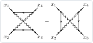
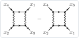
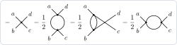
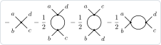

A four-point function is drawn with its labels at the corners, counterclockwise from the top left. For Γ⁰ the default
order suits the particle–hole channels; in a particle–particle diagram the two particles then enter on opposite sides
and the interaction lines cross. `"ExternalOrder"` changes the order, and `"Uncrossed"` uncrosses the legs of each
diagram that needs it.

## Sorting the diagrams by channel

The irreducible vertex of the electron gas to second order, Γ⁰ = δ²Φ/δG(x₄, x₃)δG(x₂, x₁), and its diagrams by channel:

```mathematica
Needs["FunctionalDiagrams`"]
DeclareGrassmannSource[eta, etabar];
DeclareField[psi, etabar]; DeclareField[psibar, eta, -1];
Z0 = Exp[-IntegralOver[G0[x, y] etabar[x] ** eta[y], {x, y}]];
DeclareSymmetric[V]; DeclareInteractionLine[V]; DeclareDirectedPropagator[G0, G];
interaction =
  1/2 IntegralOver[V[x, y] psibar[x] ** psibar[y] ** psi[y] ** psi[x], {x, y}];
Phi = LuttingerWardFunctional[Z0, interaction, 2, G0 -> G];
gamma0 = FunctionalDerivative[Phi, G[x4, x3], G[x2, x1]];
channels = ParquetDecomposition[gamma0, {x1, x2, x3, x4}, {G}];
Length[DiagramTerms[#]] & /@ channels
```

```text
<|FullyIrreducible -> 2, ParticleHole -> 0, TransverseParticleHole -> 4, ParticleParticle -> 2, SeveralChannels -> 0|>
```

Γ⁰ is irreducible in the particle–hole channel, as it should be; `"SeveralChannels"` would collect the diagrams reducible
in more than one channel, which the parquet theorem excludes. The two particle–particle diagrams, in the default order:

```mathematica
DiagramPlot[channels["ParticleParticle"], {x1, x2, x3, x4}]
```



With the incoming legs on the left, `"ExternalOrder" -> {"Uncrossed", {x4, x2, x3, x1}}`, the two particles propagate
from left to right and the diagrams are ladders: the corners go x₄, x₂, x₃, x₁, with x₁ and x₃ exchanged where needed so
the lines stay parallel:

```mathematica
DiagramPlot[channels["ParticleParticle"], {x1, x2, x3, x4},
  "ExternalOrder" -> {"Uncrossed", {x4, x2, x3, x1}}]
```



The two pictures are the same diagrams: only the corners differ. The labels keep their meaning, so the weights do not
change.

## Bosons

The channels of a real boson are s (a b | c d), t (a c | b d) and u (a d | b c), with a, b, c, d at the corners in this
order: the diagrams of t join opposite corners. The four-point vertex of φ⁴ theory to second order, the fourth
derivative of the 1PI effective action Γ[φ̄] at φ̄ = 0 (here computed with bare lines, see
[Conventions](Conventions#effective-actions)):

```mathematica
DeclareSource[J]; DeclareField[phi, J]; DeclareSymmetric[D0]; DeclareCoupling[lambda];
Zb = Exp[1/2 IntegralOver[J[x] D0[x, y] J[y], {x, y}]];
phi4 = lambda/24 IntegralOver[phi[z]^4, {z}];
gamma1PI = EffectiveAction1PI[Zb, phi4, 2, phi -> phiMean, D0 -> D0];
gamma4 = SetSourcesToZero[FunctionalDerivative[gamma1PI,
    phiMean[a], phiMean[b], phiMean[c], phiMean[d]]];
DiagramPlot[gamma4, {a, b, c, d}]
```



The point vertex, and one bubble in each of the channels u, t and s; Γ⁽⁴⁾ is minus the amputated 1PI four-point
function, hence the weights −1 and −½. The bubble of t keeps the corners in the order given, and its legs c and d
cross as an X just outside it. With `"Uncrossed"` these two legs are exchanged, the labels moving with them:

```mathematica
DiagramPlot[gamma4, {a, b, c, d}, "ExternalOrder" -> "Uncrossed"]
```



## Notes

- `"ExternalOrder"` takes any order of the external labels, also for other functions (a three-point vertex, a
  correlation function with its points at the corners); `"Uncrossed"` acts on the diagrams with four external points.
- `"ExternalOrder" -> {x4, x2, x3, x1}` alone keeps that order in every diagram (the legs x₁ and x₃ of the second
  particle–particle diagram cross); `"Uncrossed"` alone starts from x₁, x₂, x₃, x₄ and draws one ladder upright.
- `BetheSalpeterLadder[L, R, {x1, x2, x3, x4}, "ParticleParticle", G]` joins two vertices by the pair of propagators of
  the channel, −½ L(x₁, 5; x₃, 6) G(5, 7) G(6, 8) R(7, x₂; 8, x₄): the ladders of the T-matrix.
- The kernel irreducible in the particle–particle channel is a derivative with respect to the anomalous propagators:
  `IrreducibleVertex[..., "Channel" -> "ParticleParticle"]` gives the message `ppkernel`. It is the channel t of the
  superfield (ψ, ψ̄), projected with `SuperfieldComponents` (manual: *Superfields*).
- [Conventions](Conventions#channels) lists the channels; the showcase draws Γ⁰, F and the parquet decomposition to
  third order.
