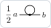

# Pictures in LaTeX

`DiagramToTikZ` gives the pictures of `DiagramPlot` as TikZ code for a paper: a sum of `tikzpicture`s, each with its
weight, to be used in math mode. `ExpressionToLaTeX` gives the formula of the same expression.

## The TikZ code

The self-energy of φ⁴ theory at first order:

```mathematica
Needs["FunctionalDiagrams`"]
DeclareSource[J]; DeclareField[phi, J]; DeclareSymmetric[D0]; DeclareCoupling[lambda];
Zb = Exp[1/2 IntegralOver[J[x] D0[x, y] J[y], {x, y}]];
phi4 = lambda/24 IntegralOver[phi[z]^4, {z}];
propagator = PerturbativeCorrelationFunction[Zb, {phi[a], phi[b]}, phi4, {1}];
sigma = AmputateExternalLegs[propagator, {a, b}, {D0}];
DiagramToTikZ[sigma, {a, b}]
```

```latex
\frac{1}{2}\,\begin{tikzpicture}[x=0.700cm, y=0.700cm, line width=0.700pt, baseline={([yshift=-0.6ex]0,0)}]
  \draw (0.000,0.000) arc[start angle=270.000, end angle=630.000, radius=0.280];
  \draw (0.000,0.000) -- (-0.600,0.000);
  \draw (0.000,0.000) -- (0.600,0.000);
  \fill (0.000,0.000) circle (0.064);
  \node[font=\small, inner sep=0pt, anchor=0] at (-0.690,0.000) {$a$};
  \node[font=\small, inner sep=0pt, anchor=180] at (0.690,0.000) {$b$};
\end{tikzpicture}
```



The code needs, in the preamble,

```latex
\usepackage{tikz}
\usetikzlibrary{decorations.pathmorphing}
```

(the library draws the straight wavy and zigzag lines; arcs of these styles are explicit curves, and arrow heads are
small filled polygons, so the pictures compile at any scale). Write the code to a file,

```mathematica
Export["sigma.tex", DiagramToTikZ[sigma, {a, b}], "Text"]
```

```text
sigma.tex
```

and input it in math mode, where the pictures sit on the math axis, aligned with the signs and the weights:

```latex
The self-energy of $\phi^4$ theory at first order is
\[ \Sigma(a, b) = \input{sigma.tex} \]
```

## Size and labels

The options of `DiagramPlot` work here too (`"ExternalOrder"`, `"LegDirections"`, `"Couplings"`, ...); these set the
look on the page:

| option | value by default | |
|---|---|---|
| `"Scale"` | `0.7` | centimetres per unit of the drawing |
| `"LineWidth"` | `0.7` | the width of the lines in pt; arrow heads, dashes, waves and double lines follow it |
| `"LabelFont"` | `"\\small"` | the font command of the labels |
| `"Labels"` | `{}` | rules from labels to LaTeX, `{a -> "x_1"}`; by default `x12` is written x₁₂, `lambda` λ, `etabar` η̄ |

`SetOptions[DiagramToTikZ, "Scale" -> 0.5]` changes a default for the session. The showcase uses `"Scale" -> 0.34`,
`"LineWidth" -> 0.42` and `"LabelFont" -> "\\tiny"` for its small pictures.

## One picture at a time

`"Output" -> "List"` gives the pairs {weight, picture} as strings, to arrange them yourself (a table, an `align`
environment, a sum broken over several lines):

```mathematica
pieces = DiagramToTikZ[sigma, {a, b}, "Output" -> "List"];
{Length[pieces], First[pieces[[1]]]}
```

```text
{1, \frac{1}{2}}
```

The whole sum, as `DiagramToTikZ` gives it, puts `\allowbreak` between the terms: in inline math (`$...$`) a long sum
breaks between two terms at the end of a line.

## Formulas

```mathematica
ExpressionToLaTeX[sigma, "Names" -> {D0 -> "D_0"}]
```

```text
-\frac{1}{2}\,\lambda\,D_0(a,a)\,\delta(a,b)
```

`"Names"` gives the LaTeX of heads (and of subexpressions), `"Labels"` that of labels, `"Subscripts"` the heads whose
arguments are written as a subscript, ξ_p for `xi[p]`. The integrals are written with their variables as a subscript,
the Grassmann products in their order. See the manual, sections *Pictures* and *Formulas in LaTeX*.
