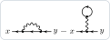

# Reading the weights

`DiagramPlot` writes a number in front of every picture: its **weight**. The rule is the one of the textbooks: the
weight, times the values of the elements of the picture, integrated over the internal points, is the term.

- a propagator stands for itself (an arrow from y to x is G(x, y));
- an interaction line (declared with `DeclareInteractionLine`) stands for **−V**;
- a vertex stands for **minus its coupling** (declared with `DeclareCoupling`), and a local vertex
  (`DeclareLocalVertex`) for minus its kernel.

The minus signs are those of exp(−S_int): with them the weight of a diagram is its symmetry factor times the sign of its
fermion loops, and does not depend on the order.

## The electron gas at first order

The electron gas of the README, and its self-energy at first order as the derivative of the Luttinger–Ward functional,
Σ(x, y) = δΦ/δG(y, x):

```mathematica
Needs["FunctionalDiagrams`"]
DeclareGrassmannSource[eta, etabar];
DeclareField[psi, etabar]; DeclareField[psibar, eta, -1];
Z0 = Exp[-IntegralOver[G0[x, y] etabar[x] ** eta[y], {x, y}]];
DeclareSymmetric[V]; DeclareInteractionLine[V]; DeclareDirectedPropagator[G0, G];
interaction =
  1/2 IntegralOver[V[x, y] psibar[x] ** psibar[y] ** psi[y] ** psi[x], {x, y}];
Phi = LuttingerWardFunctional[Z0, interaction, 1, G0 -> G];
sigma = FunctionalDerivative[Phi, G[y, x]]
```

```text
DeltaFunction[x, y] IntegralOver[G[z1, z1] V[x, z1], {z1}] - G[x, y] V[x, y]
```

```mathematica
DiagramPlot[sigma, {x, y}]
```



The Fock term, −G(x, y) V(x, y), is drawn with the weight +1: one line G and one wavy line, −V. The Hartree term,
+δ(x, y) ∫ G(z, z) V(x, z), has the weight −1: (−1) × (−V) × G gives it back. The −1 is the sign of its closed fermion
loop: a diagram of G or Σ with n closed loops has the weight (−1)ⁿ.

```mathematica
ClosedLoopCount[#, {G}] & /@ DiagramTerms[sigma]
```

```text
{1, 0}
```

The expression itself keeps the coefficients, +1 for Hartree and −1 for Fock: `DiagramTerms` lists the terms with
them, and `DiagramPlot[sigma, {x, y}, "Weights" -> "Coefficients"]` writes the coefficients in front of the pictures,
every line and vertex then standing for its own kernel.

## Couplings: φ⁴ theory

A coupling declared with `DeclareCoupling` is absorbed into the vertices. The propagator of φ⁴ theory at first order:

```mathematica
DeclareSource[J]; DeclareField[phi, J]; DeclareSymmetric[D0]; DeclareCoupling[lambda];
Zb = Exp[1/2 IntegralOver[J[x] D0[x, y] J[y], {x, y}]];
phi4 = lambda/24 IntegralOver[phi[z]^4, {z}];
propagator = PerturbativeCorrelationFunction[Zb, {phi[a], phi[b]}, phi4, 1]
```

```text
           lambda IntegralOver[D0[a, z1] D0[b, z1] D0[z1, z1], {z1}]
D0[a, b] - ---------------------------------------------------------
                                       2
```

The tadpole is −λ/2 ∫ D₀ D₀ D₀, and its vertex stands for −λ: its weight is ½, the symmetry factor. The weights that
`DiagramPlot` writes, as LaTeX strings, are those of `DiagramToTikZ` with `"Output" -> "List"`:

```mathematica
First /@ DiagramToTikZ[propagator, {a, b}, "Output" -> "List"]
```

```text
{1, \frac{1}{2}}
```

Without `DeclareCoupling[lambda]` the weight would be −λ/2. For one picture only, the option `"Couplings" -> {lambda}`
does the same as the declaration.

## More

- An interaction declared in another style (`DeclareInteractionLine[W, "DoubleWavy"]`) still stands for minus itself;
  a line declared only with `DeclareLineStyle` (a phonon, `"Dashed"`) is a propagator and stands for itself. The
  option `"Interactions" -> {W}` treats `W` as an interaction line in one picture.
- An anomalous line (`"DivergingArrows"`, `"ConvergingArrows"`) shows no orientation: the weight reads it along its
  fermion line, around a loop in either sense, along an open line from its end at the first external label.
- The manual, section *The weights*, has the details; [Conventions](Conventions) the signs of the propagators.
